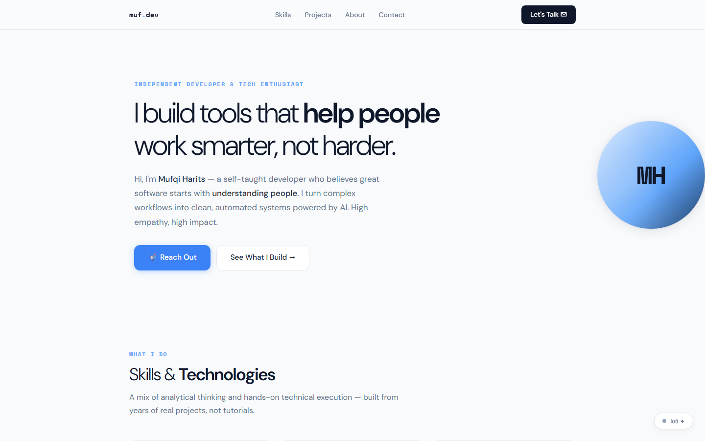
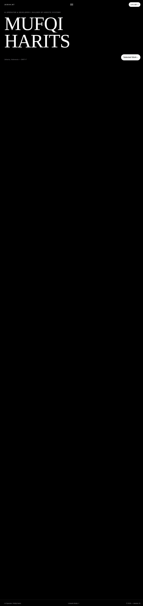

# Mufqi Harits — Portfolio

> Personal portfolio of a developer, builder, and independent thinker who works with empathy and ships with impact.

---

## About

This is my personal portfolio — a space where I share who I am, what I build, and how I think.

I specialize in building AI-powered productivity tools, automations, and web applications. Every project I take on starts with understanding the problem deeply before writing a single line of code. High empathy, high impact.

Currently focused on: AI integration, automation workflows, and personal productivity systems.

---

## Preview

---

## What's Inside

| File | Description |
|------|-------------|
| `index.html` | Personal portfolio website |
| `app.config.ts` | Configuration metadata |
| `server.mjs` | Node.js HTTP server |
| `package.json` | Project dependencies |
| `scripts/` | Build & utility scripts |
| `public/` | Static assets |
| `preview-home.png` | Homepage screenshot |
| `v2-dark-style/` | V2 — "Midnight Ember" dark style variant |

## V2 — Midnight Ember (Dark Style)

Dark variant of the live Lightvela design: pure black canvas, white serif display type, warm ember-orange accent `#ff630f`.

| File | Description |
|------|-------------|
| `v2-dark-style/index.html` | Full standalone V2 page |
| `v2-dark-style/preview-v2-full.png` | Full-page screenshot |
| `v2-dark-style/preview-v2-hero.png` | Hero screenshot |

Sections: Hero → Design Approach → Featured Project (UraiNote Agentic) → Selected Work (6 projects) → Capabilities → Contact.
